 

<h2 align="center">01 &nbsp;/&nbsp; About</h2>

<i>Engineer by trade, founder by intent.</i>

Four years turning ideas into production software across fintech, commerce and logistics — 
mobile and web, architecture to launch, with the ownership of someone who intends to build companies, not just features.

<table align="center">
<tr>
<td width="33%" valign="top">

**01 · Ownership**

I treat the product as mine — from the data model to the app-store listing to the 2 a.m. incident.

</td>
<td width="33%" valign="top">

**02 · Pragmatism**

The simplest architecture that will survive real users, real payments and real growth.

</td>
<td width="33%" valign="top">

**03 · Craft**

Interfaces that feel considered, code the next engineer is glad to inherit.

</td>
</tr>
</table>

<code>Addis Ababa, Ethiopia</code> &nbsp;·&nbsp; <code>English · Amharic · Oromiffaa</code> &nbsp;·&nbsp; <code>Cursor-assisted workflow</code> &nbsp;·&nbsp; <code>Exploring Kubernetes &amp; cloud-native</code>

<h2 align="center">02 &nbsp;/&nbsp; Capabilities</h2>

<i>A full-stack toolkit, chosen with care — including local payment rails like Telebirr and Chapa.</i>

<table align="center">
<tr>
<td valign="top" width="33%" align="center">

**01 · Mobile**

</td>
<td valign="top" width="33%" align="center">

**02 · Frontend**

</td>
<td valign="top" width="33%" align="center">

**03 · Backend**

</td>
</tr>
<tr>
<td valign="top" align="center">

**04 · Database**

</td>
<td valign="top" align="center">

**05 · Cloud &amp; DevOps**

</td>
<td valign="top" align="center">

**06 · Payments &amp; Tools**

<code>Stripe</code> <code>PayPal</code> <code>Chapa</code> <code>Telebirr</code>
  
 <code>Cursor</code>

</td>
</tr>
</table>

<h2 align="center">03 &nbsp;/&nbsp; Selected Work</h2>

<i>Products in production, not on a whiteboard. 15 shipped across banking, commerce and logistics.</i>

<table>
<tr>
<td width="50%" valign="top">

### 01 · Merchant Nation Command
<code>COOPERATIVE BANK OF OROMIA</code>

Field operations and branch management platform. Solo build — Next.js frontend, Node.js backend, full cloud deployment.

<code>Next.js</code> · <code>Node.js</code> · <code>TypeScript</code> · <code>AWS</code> · <code>PostgreSQL</code>

[**Live demo →**](https://merchant-nation-2omx.vercel.app)

</td>
<td width="50%" valign="top">

### 02 · Michu-Mizan
<code>COOPERATIVE BANK OF OROMIA</code>

Interest-free, Sharia-compliant financing for micro, small and medium enterprises, supporting ethical business growth.

<code>Flutter</code> · <code>Dart</code> · <code>Firebase</code> · <code>Stripe</code>

[**Website →**](https://michumizan.com/en) · [**GitHub →**](https://github.com/AbdulsemedM/Is-Fin)

</td>
</tr>
<tr>
<td width="50%" valign="top">

### 03 · CommercePal
<code>HUDHUD CORPORATION PLC</code>

Full-featured B2B and B2C e-commerce app with **50K+ downloads** on Google Play.

<code>Flutter</code> · <code>Firebase</code> · <code>Stripe</code> · <code>BLoC</code>

[**Google Play →**](https://play.google.com/store/apps/details?id=com.commercepal.commercepal) · [**GitHub →**](https://github.com/AbdulsemedM/Com-Cus)

</td>
<td width="50%" valign="top">

### 04 · AbayMart
<code>HUDHUD CORPORATION PLC</code>

Customer shopping app with Telebirr payments, order tracking and in-app chat.

<code>Flutter</code> · <code>Firebase</code> · <code>Telebirr</code> · <code>Node.js</code>

[**Website →**](https://abbaymart.com) · [**Google Play →**](https://play.google.com/store/apps/details?id=com.abaymart.user)

</td>
</tr>
<tr>
<td width="50%" valign="top">

### 05 · HudHud Express
<code>HUDHUD CORPORATION PLC</code>

Smart logistics and courier management. Manage shipments, track deliveries, scan barcodes and update order statuses in real time.

<code>Flutter</code> · <code>Firebase</code> · <code>Socket.io</code> · <code>Stripe</code>

[**Google Play →**](https://play.google.com/store/apps/details?id=com.hudhud.courier) · [**GitHub →**](https://github.com/AbdulsemedM/Courier-App)

</td>
<td width="50%" valign="top">

### 06 · VSLA Mobile App
<code>COOPERATIVE BANK OF OROMIA</code>

Structured savings, loan access and financial literacy for rural communities: member ledger, meetings and secure loan applications.

<code>Flutter</code> · <code>Dart</code> · <code>Firebase</code> · <code>Spring Boot</code> · <code>React</code>

[**GitHub →**](https://github.com/AbdulsemedM/Saving-Agency)

</td>
</tr>
</table>

Also shipped &nbsp;·&nbsp; <a href="https://dxvalley.com">DxValley</a> · <a href="https://github.com/AbdulsemedM/Cooperatives-Management-system">Bank Cooperatives Management System</a> · Michu Lending Affiliate · <a href="https://abbaystock.com/">AbayStock</a> · <a href="https://abbaycrm.com/">AbayCRM</a> · Hudhud Delivery &amp; Driver · Tina Driver · <a href="https://iseey.app/">ISEEY</a>
 
<a href="https://abdulsemedm.vercel.app/#work"><b>See all 15 on the portfolio →</b></a>

<h2 align="center">04 &nbsp;/&nbsp; Experience</h2>

<table align="center">
<tr>
<td width="18%" valign="top"><code>SEP 2023 – NOW</code></td>
<td valign="top"><b>Cooperative Bank of Oromia</b> — Software Engineer I Fintech platforms, mobile apps and innovation-ecosystem tools used across branches and field operations.</td>
</tr>
<tr>
<td valign="top"><code>JAN 2023 – NOW</code></td>
<td valign="top"><b>HudHud Corporation PLC</b> — Software Engineer E-commerce and logistics products with 50K+ downloads, real-time tracking and payment integrations.</td>
</tr>
<tr>
<td valign="top"><code>2017 – 2022</code></td>
<td valign="top"><b>Jimma University</b> — B.Sc. Computer Engineering Software engineering, embedded systems and computer architecture.</td>
</tr>
</table>

<h2 align="center">05 &nbsp;/&nbsp; GitHub</h2>

 

  

<picture>
  <source media="(prefers-color-scheme: dark)" srcset="https://raw.githubusercontent.com/AbdulsemedM/AbdulsemedM/output/github-snake-dark.svg" />
  <source media="(prefers-color-scheme: light)" srcset="https://raw.githubusercontent.com/AbdulsemedM/AbdulsemedM/output/github-snake.svg" />
  
</picture>

<h2 align="center">06 &nbsp;/&nbsp; Recognition</h2>

<table align="center">
<tr>
<td align="center" width="25%"><b>Winner</b> Computer Stream final-year project competition</td>
<td align="center" width="25%"><b>2nd Place</b> Jimma Institute of Technology project showcase</td>
<td align="center" width="25%"><b>Winning Team</b> Hack into Bright Ethiopia Hackathon</td>
<td align="center" width="25%"><b>50K+ Downloads</b> Google Play Store</td>
</tr>
</table>

<h2 align="center">07 &nbsp;/&nbsp; Have an idea worth building?</h2>

<i>I'm exploring co-founding opportunities and a few select engagements. Investors, founders and teams with a hard problem — I'd love to hear from you.</i>

  

 

